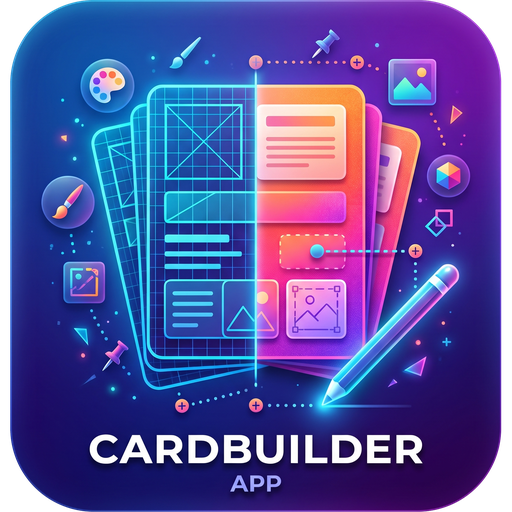
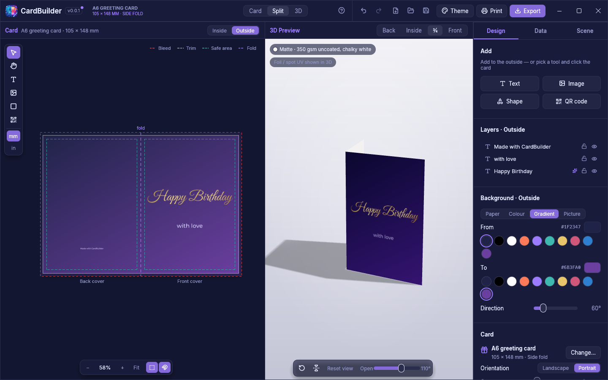

<p align="center">
  
</p>

<h1 align="center">CardBuilder</h1>

<p align="center">
  <a href="https://github.com/BR1ZB3AR/CardBuilder/releases/latest/download/CardBuilder-x86_64.msi"></a>
  <a href="https://github.com/BR1ZB3AR/CardBuilder/releases/latest/download/CardBuilder-x86_64.AppImage"></a>
</p>

Design cards of every kind — business cards, ID and gift cards, playing and trading cards,
postcards and invitations, folded greeting cards, tent and place cards, bookmarks and tags — and
see them in 3D, in real card stock, as you go. When you're done, print them: vector PDFs with
bleed, crop marks and the backs lined up for double-sided printing.



## Features

- **Every kind of card:** 39 ready-made sizes (business cards for Europe, the US, Asia, Japan and
  Australia; CR80 ID, badge and gift cards; poker, bridge, trading, tarot and mini game cards and Ingress agent biocards (Enlightened and Resistance); A6,
  4×6, 5×7, A5 and DL postcards; A6, A5, 5×7, square and DL greeting cards; place cards and table
  tents; bookmarks, hang tags and labels) or any custom size — flat, side-folded or top-folded,
  with rounded corners.
- **Both sides:** front and back, or the outside and inside spreads of a folded card, with bleed,
  trim, safe-area and fold guides, and snapping to centre lines and the safe area.
- **Artwork:** text in 15 fonts (sizes in points, wrapping or shrink-to-fit), pictures (PNG, JPEG,
  WebP, GIF, SVG), rectangles, ellipses and lines, and backgrounds in colour, gradient or a picture.
- **QR codes** for a website, a contact card (vCard), Wi-Fi, a phone number or an email address —
  sharp vectors, with a warning when a code gets too small to scan.
- **Batch cards:** import a spreadsheet (CSV) and put `{Column}` fields in text and QR codes — one
  card per row, previewed row by row.
- **Finishes:** gold, silver, copper, rose-gold and holographic foil, and spot UV varnish — shown
  in 3D and exported as separate pages for the print shop.
- **3D preview** on your graphics card: matte, silk, gloss, soft-touch, linen, kraft, pearl, black
  or plastic stock, studio lighting and soft shadows; folded cards stand open at any angle.
- **Print:** print sheets (as many cards per page as fit on A4, A3, SRA3, Letter, …, with crop
  marks and double-sided imposition), a card PDF with bleed and trim boxes, 300 dpi PNGs and a
  2000 px 3D snapshot.
- **Design files:** `.cb` files with pictures and data inside; New, Open, Save, undo for everything.
- 31 themes, a custom title bar, and a layout that adapts down to small windows.

## Build from source

You need a recent stable Rust toolchain ([rustup](https://rustup.rs)) — on Windows with the MSVC
build tools that rustup offers to install; no other development libraries.

```sh
cargo run --release -p cardbuilder
```

To put it in your app launcher (it builds a release, installs it to `~/.local/bin`, and registers
`.cb` files so they open with a double-click):

```sh
./packaging/install-desktop.sh              # --uninstall removes it again
```

To build an AppImage yourself: `./packaging/build-appimage.sh` (→ `target/appimage/`). Release
builds are made by [the release workflows](.github/workflows): the AppImage in Ubuntu 22.04 (so it
runs on glibc 2.35 and newer), the Windows installer with [WiX](https://wixtoolset.org)
([`packaging/windows`](packaging/windows)).

## Using it

- **Add › Text / Image / Shape / QR code**, or pick a tool on the left and click the card.
- Drag to move (Alt: no snapping), a corner to resize, the side handles to change a text box's
  width, the knob to rotate. Double-click text to edit it.
- **Front / Back** (or **Outside / Inside**) above the card switches the printed side; **Tab** too.
- **Data** turns one design into many cards; **[** and **]** step through the rows.
- **Print** (Ctrl+P) lays the cards out on sheets; **Export** has the card PDF, PNGs and the 3D snapshot.
- Press **?** in the top bar for all keyboard shortcuts.

## Project layout

| crate | what it does |
|---|---|
| [`crates/cb-core`](crates/cb-core) | card formats, the design model and `.cb` files, CSV data and `{fields}`, print-sheet imposition, the 3D card mesh, undo/redo — plain Rust, no UI |
| [`crates/cb-print`](crates/cb-print) | the renderer (tiny-skia, rustybuzz, resvg, qrcode): card sides as pixels or as vector PDF, print sheets |
| [`crates/cardbuilder`](crates/cardbuilder) | the app (egui + wgpu): top bar, card editor, 3D preview, Design / Data / Scene sidebar |

## Tests

```sh
cargo test --workspace
# renders the real app on the GPU and saves screenshots:
CB_SCREENSHOT_DIR=/tmp/cb cargo test -p cardbuilder --test screenshots -- --ignored
```

The tests check the formats, imposition (every back lands behind its front), CSV and fields, that
generated QR codes scan, the PDFs, and the interface itself: they click, drag, resize and rotate
like a user would.

## License

CardBuilder is released under the [MIT License](LICENSE).

The bundled fonts — Anton, Bangers, Bebas Neue, Cormorant Garamond, Dancing Script, Great Vibes,
Inter, Lora, Montserrat, Oswald, Pacifico, Permanent Marker, Playfair Display, Space Grotesk and
Space Mono — are licensed under the SIL Open Font License 1.1; see
[`crates/cardbuilder/assets/fonts`](crates/cardbuilder/assets/fonts).
