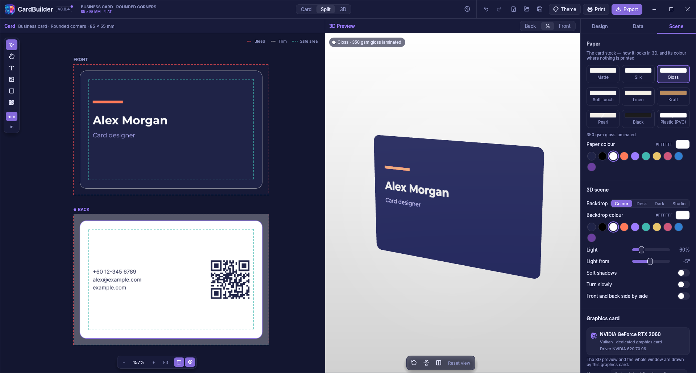
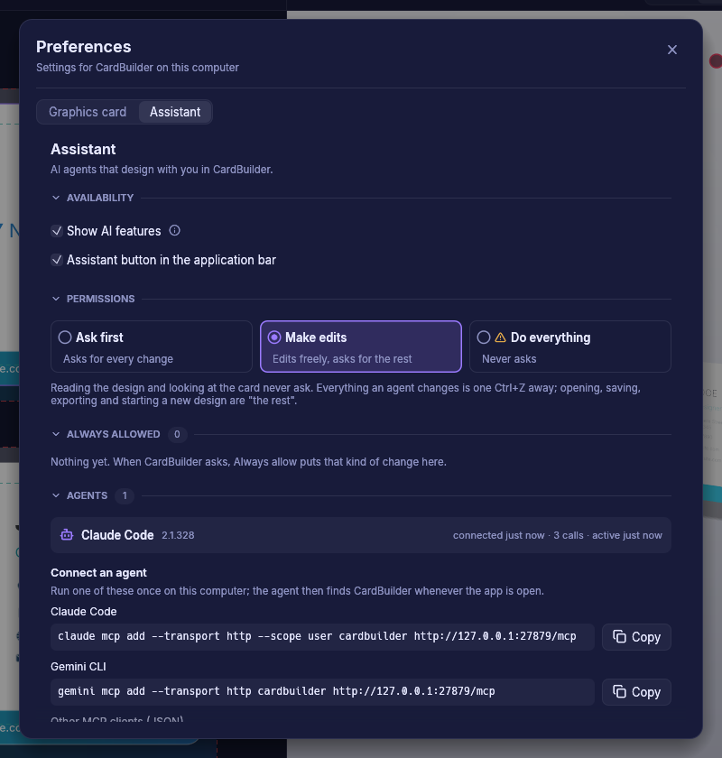
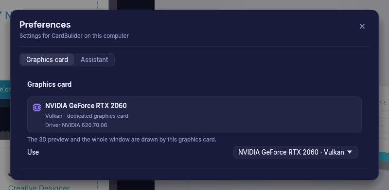
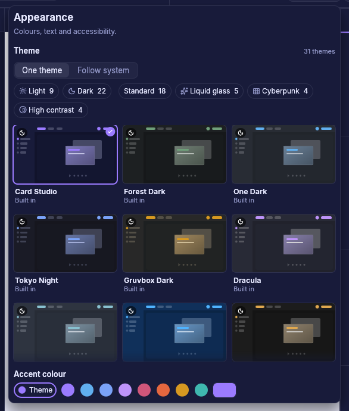
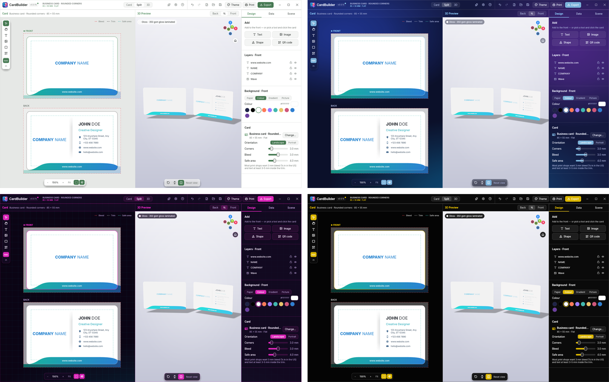

<p align="center">
  
</p>

<h1 align="center">CardBuilder</h1>

<p align="center">
  <a href="https://github.com/BR1ZB3AR/CardBuilder/releases/latest/download/CardBuilder-x86_64.msi"></a>
  <a href="https://github.com/BR1ZB3AR/CardBuilder/releases/latest/download/CardBuilder-x86_64.AppImage"></a>
  <a href="https://br1zb3ar.github.io/CardBuilder/"></a>
</p>

Design cards of every kind — business cards, ID and gift cards, playing and trading cards,
postcards and invitations, folded greeting cards, tent and place cards, bookmarks and tags — and
see them in 3D, in real card stock, as you go. When you're done, print them: vector PDFs with
bleed, crop marks and the backs lined up for double-sided printing.



## Features

- **Every kind of card:** 39 ready-made sizes (business cards for Europe, the US, Asia, Japan and
  Australia; CR80 ID, badge and gift cards; poker, bridge, trading, tarot and mini game cards and Ingress agent biocards (Enlightened and Resistance); A6,
  4×6, 5×7, A5 and DL postcards; A6, A5, 5×7, square and DL greeting cards; place cards and table
  tents; bookmarks, hang tags and labels) or any custom size — flat, side-folded or top-folded,
  with rounded corners.
- **Both sides:** front and back, or the outside and inside spreads of a folded card, with bleed,
  trim, safe-area and fold guides, and snapping to centre lines and the safe area.
- **Artwork:** text in 17 fonts (sizes in points, wrapping or shrink-to-fit), pictures (PNG, JPEG,
  WebP, GIF, SVG), rectangles, ellipses and lines, vector shapes of any outline (a template's
  frames, logos and patterns, each a layer you can recolour, resize or delete), solid, dashed or
  dotted outlines, and backgrounds in colour, gradient or a picture. A layer can be clipped to
  the one below it, such as a photo in a window shape.
- **QR codes** for a website, a contact card (vCard), Wi-Fi, a phone number or an email address —
  sharp vectors, with a warning when a code gets too small to scan.
- **Batch cards:** import a spreadsheet (CSV) and put `{Column}` fields in text and QR codes — one
  card per row, previewed row by row.
- **Finishes:** gold, silver, copper, rose-gold and holographic foil, and spot UV varnish — shown
  in 3D and exported as separate pages for the print shop.
- **3D preview** on your graphics card: matte, silk, gloss, soft-touch, linen, kraft, pearl, black
  or plastic stock, studio lighting and soft shadows; folded cards stand open at any angle.
- **Print:** print sheets (as many cards per page as fit on A4, A3, SRA3, Letter, …, with crop
  marks and double-sided imposition), a card PDF with bleed and trim boxes, 300 dpi PNGs and a
  2000 px 3D snapshot.
- **Your own templates and fonts:** save any design as a template and it shows in the card
  picker (in its category and group); add .ttf / .otf fonts, which travel inside the design.
  A design can offer a choice as coloured buttons (say, a faction: RES, ENL or XFAC), each
  showing its own layers and setting colours.
- **Design files:** `.cb` files with pictures, fonts and data inside; New, Open, Save, undo for everything.
- **Assistant (desktop):** AI agents such as Claude Code or Gemini CLI design with you over
  [MCP](https://modelcontextprotocol.io). CardBuilder listens on this computer only
  (`http://127.0.0.1:27879/mcp`, off until you turn it on in Preferences › Assistant). Agents can read the
  design, add and change layers, look at the card and export it. You choose what they may do
  without asking, every change is one Ctrl+Z away, and a pointer shows what the agent is working on.
- [31 themes](#themes), a custom title bar, and a layout that adapts down to small windows.

## Preferences and the Assistant

The gear in the top bar (or **Ctrl+,**) opens Preferences: settings for CardBuilder on this
computer.

<p align="center">
  
</p>

**Assistant** (desktop app): AI agents such as Claude Code or Gemini CLI design with you over
[MCP](https://modelcontextprotocol.io). They read the design, add and change layers, set
backgrounds, the card size and the data, look at the card, and open, save or export, while a
pointer shows what they are working on. You choose what they may do without asking:

- **Ask first:** every change waits for your OK.
- **Make edits:** changes go ahead, and opening, saving and exporting ask.
- **Do everything:** nothing asks.

When an agent asks, a card shows what it wants, with *Allow*, *Always allow* and *Deny*. Every
change it makes is one Ctrl+Z away. To connect one:

1. In Preferences › Assistant, tick **Let AI agents connect**. CardBuilder then listens on this
   computer only, at `http://127.0.0.1:27879/mcp`, and web pages can't reach it.
2. Add CardBuilder to your agent once. For Claude Code:
   ```sh
   claude mcp add --transport http --scope user cardbuilder http://127.0.0.1:27879/mcp
   ```
   Preferences shows the line for Gemini CLI and a JSON entry for other MCP clients.
3. Ask your agent for a card. *Custom instructions* in Preferences tell it how you like to work.

<p align="center">
  
</p>

**Graphics card:** which graphics card draws the window and the 3D preview, every card
CardBuilder found, and a choice for the next start (for a laptop with two, or when a driver
misbehaves).

## Themes

**Theme** in the top bar changes how CardBuilder looks: 31 themes, light and dark, frosted
*liquid glass*, *cyberpunk* neon and *high contrast*, each shown as a small picture of the app.
The chips at the top narrow the list, *Accent colour* puts your own colour on the buttons and
highlights, and *Follow system* switches between a light and a dark theme of your choice with your
computer's setting.

<p align="center">
  
</p>

<p align="center">
  
  <br>
  <sub>Top: Daylight, Liquid Glass. Bottom: Cyberpunk Magenta, High Contrast Amber.</sub>
</p>

## In your browser

CardBuilder also runs in a web browser, nothing to install:
**[br1zb3ar.github.io/CardBuilder](https://br1zb3ar.github.io/CardBuilder/)**, or on Codeberg at
**[br1zb3ar.codeberg.page/CardBuilder](https://br1zb3ar.codeberg.page/CardBuilder/)**. It's the
same app, built for WebAssembly. A few things work the browser's way:

- **Saving** downloads the `.cb` design (and exports their PDF or PNG) to your downloads folder;
  **Open** brings a design back in, and you can also drop `.cb` files, pictures and CSV files
  onto the page. The design you're working on is kept in the browser between visits.
- **Templates** are kept in the browser: drop `.cb` template files on the page (or use
  *Export › Import templates…*) and they show in the card picker as on the desktop; *Save as
  template…* keeps your own there, and right-clicking one in the picker removes it. They stay in
  that browser only, and clearing the site's data removes them.
- The **Assistant** is in the desktop app only (a web page can't let agents connect).
- The **3D preview** needs WebGPU or WebGL 2 (any current Chrome, Edge, Firefox or Safari), and
  big exports take a moment longer than on the desktop.

Nothing leaves your computer: the web version has no server; it runs entirely in the page.

## Build from source

You need a recent stable Rust toolchain ([rustup](https://rustup.rs)) — on Windows with the MSVC
build tools that rustup offers to install; no other development libraries.

```sh
cargo run --release -p cardbuilder
```

To put it in your app launcher (it builds a release, installs it to `~/.local/bin`, and registers
`.cb` files so they open with a double-click):

```sh
./packaging/install-desktop.sh              # --uninstall removes it again
```

To build an AppImage yourself: `./packaging/build-appimage.sh` (→ `target/appimage/`). Release
builds are made by [the release workflows](.github/workflows): the AppImage in Ubuntu 22.04 (so it
runs on glibc 2.35 and newer), the Windows installer with [WiX](https://wixtoolset.org)
([`packaging/windows`](packaging/windows)).

The web version builds with [trunk](https://trunkrs.dev) and the `wasm32-unknown-unknown` target
(`rustup target add wasm32-unknown-unknown`):

```sh
cd crates/cardbuilder
trunk serve                                  # http://127.0.0.1:8080, rebuilds as you edit
trunk build --release --public-url ./        # → dist/, what the Pages sites serve
```

## Using it

- **Add › Text / Image / Shape / QR code**, or pick a tool on the left and click the card.
- Drag to move (Alt: no snapping), a corner to resize, the side handles to change a text box's
  width, the knob to rotate. Double-click text to edit it.
- **Front / Back** (or **Outside / Inside**) above the card switches the printed side; **Tab** too.
- **Data** turns one design into many cards; **[** and **]** step through the rows.
- **Print** (Ctrl+P) lays the cards out on sheets; **Export** has the card PDF, PNGs and the 3D snapshot.
- Press **?** in the top bar for all keyboard shortcuts.

## Project layout

| crate | what it does |
|---|---|
| [`crates/cb-core`](crates/cb-core) | card formats, the design model and `.cb` files, CSV data and `{fields}`, print-sheet imposition, the 3D card mesh, undo/redo — plain Rust, no UI |
| [`crates/cb-print`](crates/cb-print) | the renderer (tiny-skia, rustybuzz, resvg, qrcode): card sides as pixels or as vector PDF, print sheets |
| [`crates/cardbuilder`](crates/cardbuilder) | the app (egui + wgpu): top bar, card editor, 3D preview, Design / Data / Scene sidebar |

## Tests

```sh
cargo test --workspace
# renders the real app on the GPU and saves screenshots:
CB_SCREENSHOT_DIR=/tmp/cb cargo test -p cardbuilder --test screenshots -- --ignored
```

The tests check the formats, imposition (every back lands behind its front), CSV and fields, that
generated QR codes scan, the PDFs, and the interface itself: they click, drag, resize and rotate
like a user would.

## License

CardBuilder is released under the [MIT License](LICENSE).

The bundled fonts — Anton, Bangers, Bebas Neue, Coda, Cormorant Garamond, Dancing Script, Exo, Great Vibes,
Inter, Lora, Montserrat, Oswald, Pacifico, Permanent Marker, Playfair Display, Space Grotesk and
Space Mono — are licensed under the SIL Open Font License 1.1; see
[`crates/cardbuilder/assets/fonts`](crates/cardbuilder/assets/fonts).
